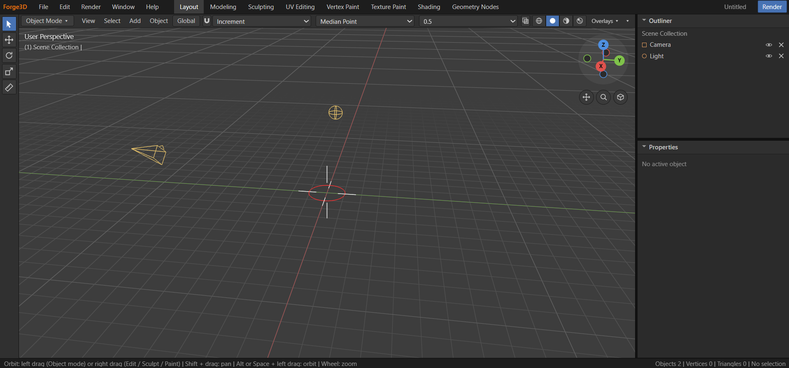
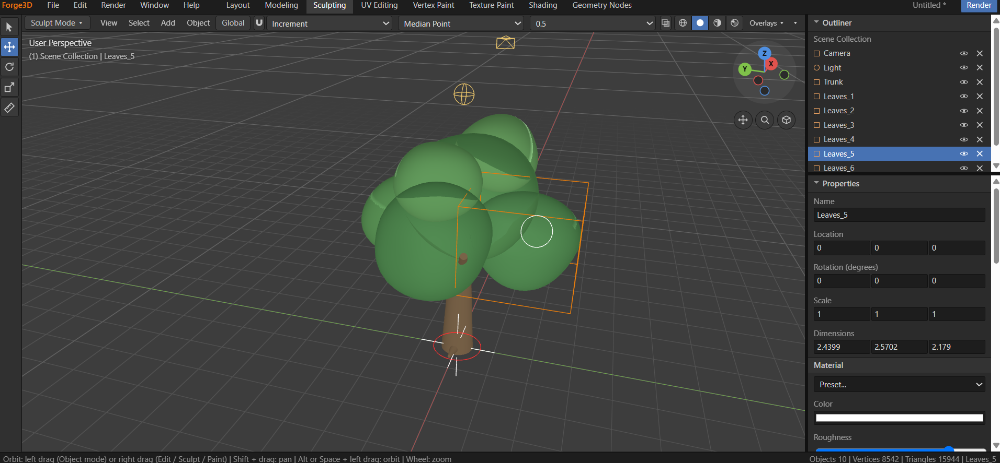
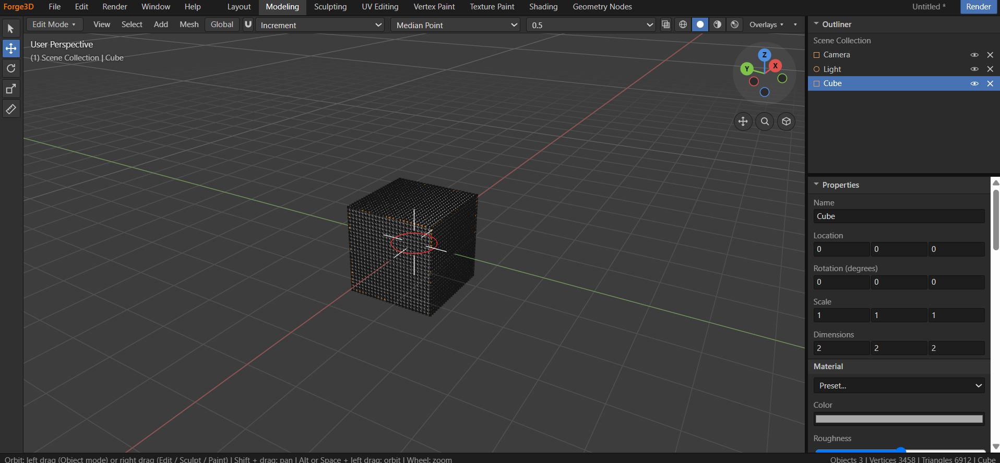
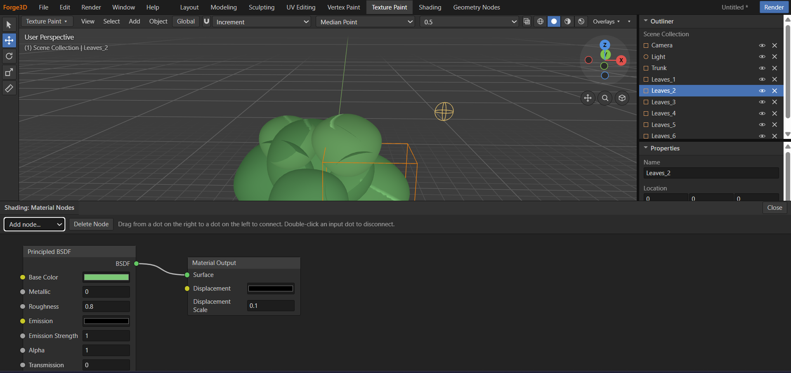
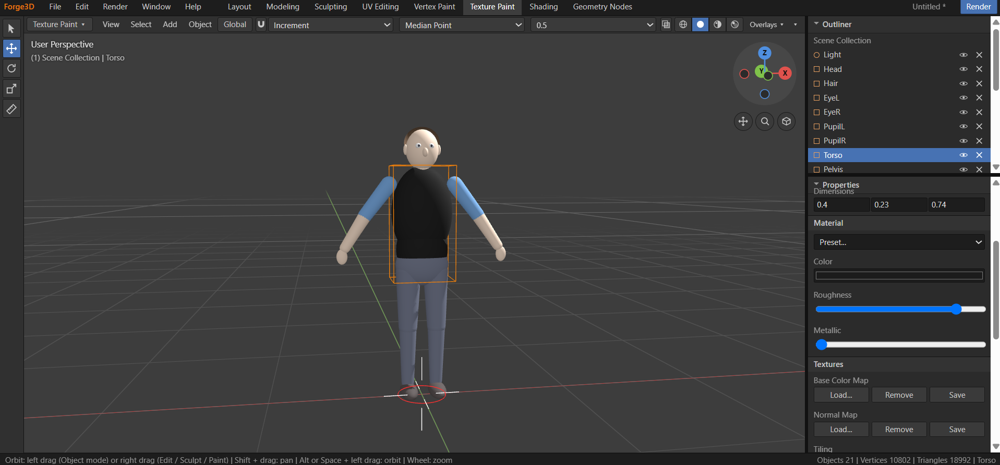
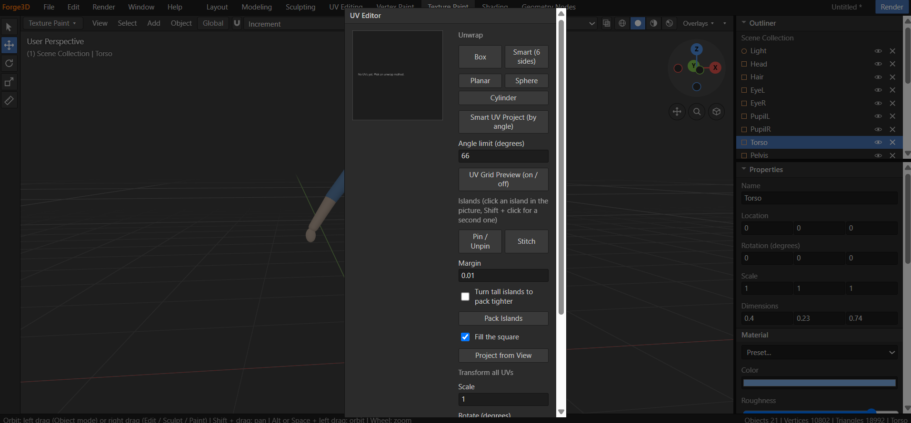
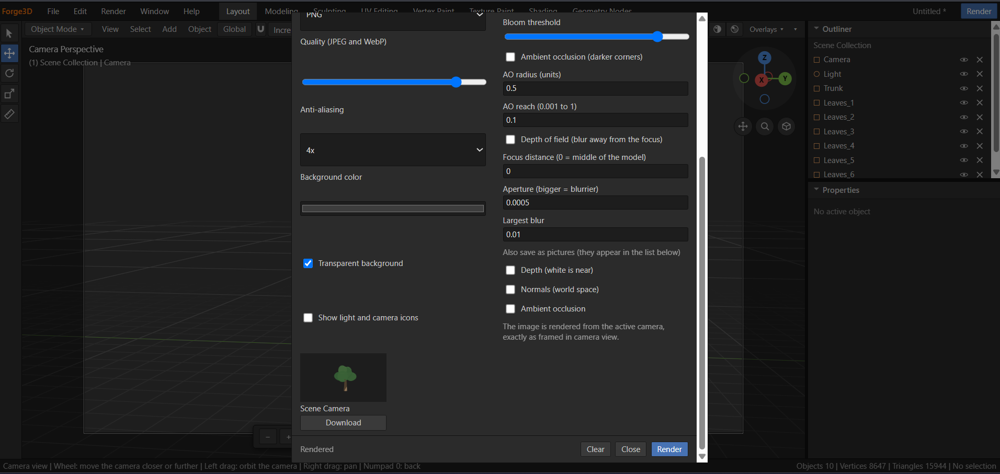
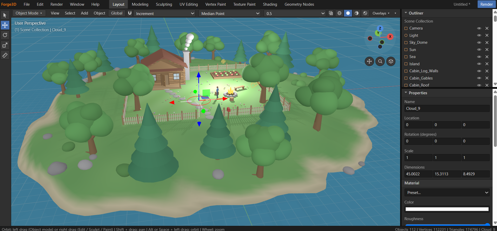
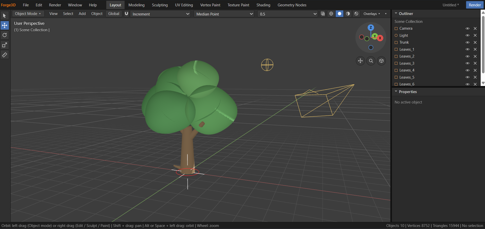
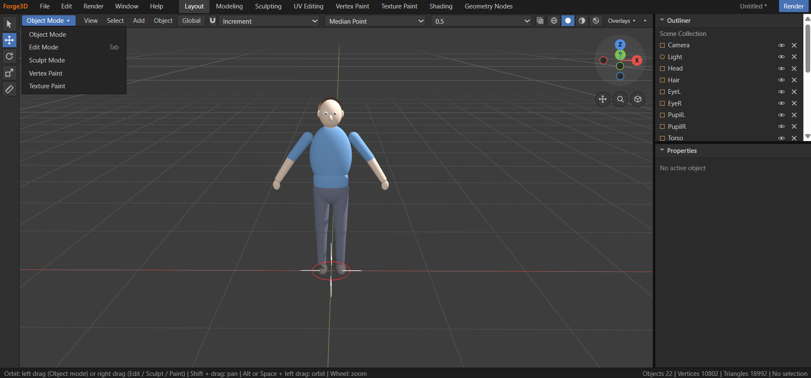

<p align="center">
  
</p>

<p align="center"><b>3D modeling in your browser.</b><br>No install. Just open it and build stuff.</p>



## Try it

Click this link to open it

https://slimshadyxroot1-png.github.io/Forge3D/

### Run it locally

```
cd forge3d
python3 -m http.server
```

Open `http://localhost:8000`

## What it can do

- Sculpting with 17 brushes
- Edit mode (extrude, inset, bevel, loop cut)
- Modifiers (mirror, array, subdivide and more)
- Texture painting + UV editor
- Material nodes + geometry nodes
- Lights, cameras and PNG render
- Import / export GLB, glTF, OBJ, STL
- Save projects as `.forge3d`

## Screenshots

**Sculpt**



**Edit mode**



**Material nodes**



**Texture paint**



**UV editor**



**Render**



## Models

Some models to try in Forge3D are in the [models](models) folder.







## Controls

| | |
|---|---|
| Orbit | left drag |
| Pan | right drag |
| Zoom | scroll |
| Search everything | `F3` or `Ctrl+K` |
| Edit mode | `Tab` |
| Save | `Ctrl+S` |

Press `F3` and pick **Run Self-Test** to check if everything works.

## Credits

Made with Three.js